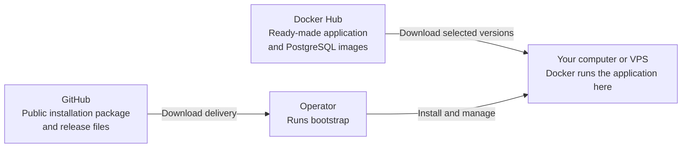
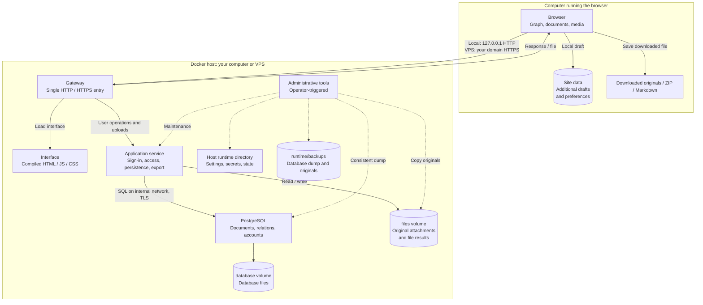
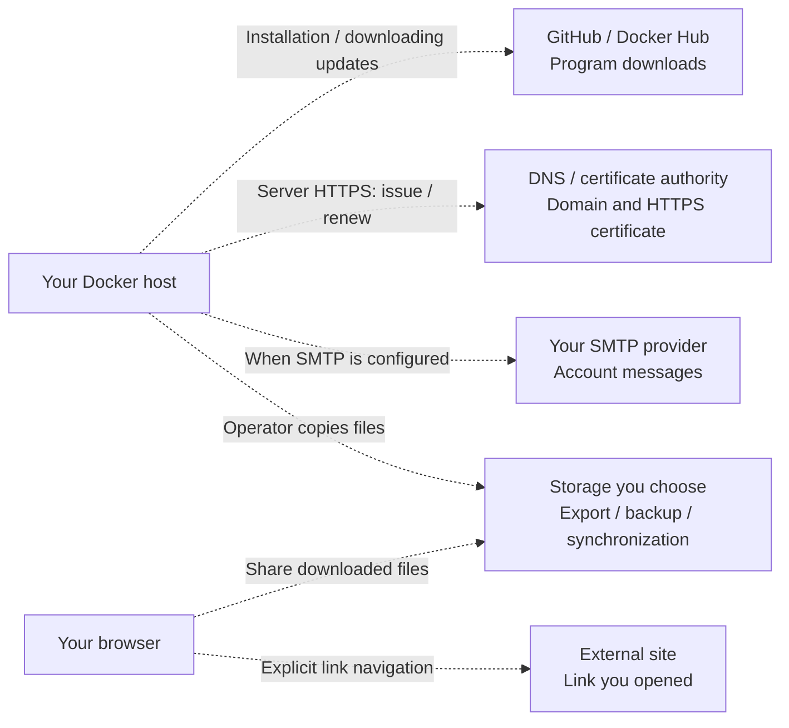

# Data and Security: How TraceWeave Works

*[Русский](../ru/data-and-security.md)*

**Data lives on the host where you run Docker.** A local installation uses your computer. A VPS installation uses that remote server; its operator and provider are within your trust boundary. The browser also holds additional drafts on the computer used to open the application.

This describes the standard 0.1.0 delivery. The diagrams reflect configuration and implementation, not an independent security audit or a guarantee that vulnerabilities cannot exist.

## Downloading and Running

GitHub and Docker Hub supply programs and updates. Standard installation commands do not upload investigations to them. Download services see your connection, IP and requested files/versions. Private component sources and registry sign-in are unnecessary. Once images are downloaded, local work with existing materials needs no internet.

## Document and File Flow

Solid arrows show user requests/data; responses follow the same path back. Dashed arrows show operator actions. Locally the browser and Docker share one computer; a VPS adds a network between them. PostgreSQL and the application service publish no host ports. The browser uses the gateway; the interface container serves UI files, while React executes in the browser.

## Where Data Lives

| Data | Location | Access |
| --- | --- | --- |
| Document text, attributes, relations, positions, accounts and service records | PostgreSQL; `database` volume at `/var/lib/postgresql` in the database container | Application service through the database, administrative tools, host administrator |
| Immutable original attachments and file results | `files` volume, `/var/lib/traceweave` in the application service | Authorized user through the application; tools and host administrator |
| Settings, secrets, state and installation journal | `runtime/` or absolute `TW_RUNTIME_DIR` | Operator and administrative tools; necessary files are mounted into services |
| Full backup | `runtime/backups/`: PostgreSQL dump and originals | Operator and anyone receiving that copy |
| HTTPS certificates and gateway state | `gateway_data` and `gateway_config` volumes | Gateway and host administrator |
| Retained files from the previous interface | `previous_assets` volume | Interface service; program files, not a research backup |
| Unsaved drafts and UI preferences | IndexedDB / localStorage in the browser profile | Profile user, permitted extensions/programs and device administrator |
| Downloaded originals, Markdown and ZIP | Downloads folder, chosen storage, Obsidian and other applications | Anyone receiving the file or access to that directory |

The table uses logical volume names. Installation-prefixed real names are saved in `runtime/installation.json`. Linux stores volumes in Docker's host storage; macOS uses Docker's Linux environment, whose disk lives on the Mac. `runtime/` is a normal host directory.

Bootstrap creates named volumes automatically. Choosing an arbitrary database/originals directory is not implemented. `TW_RUNTIME_DIR` changes only settings, secrets and backup location. Normal container stop/replacement retains volumes; deleting a volume or Docker's disk destroys its data. Copying only the installation directory does not copy the database.

A browser draft is additional recovery, not a confirmed server write. Clearing site data, deleting a profile or a crash can lose unsaved input. Preserve or download needed drafts before clearing the profile.

## What May Leave for the Internet

| Recipient | When and what it receives |
| --- | --- |
| GitHub / image registry | Delivery/image downloads reveal IP and requested program files. There is no automatic research upload to these services |
| DNS / certificate authority | Server mode: domain, IP/network requests and information needed to issue/renew TLS certificates. A public certificate does not publish investigation contents |
| SMTP / recipient mailbox | Verification/password reset: addresses, account message, one-use link and installation URL. Document text/originals are not part of these messages. The SMTP provider can read the message; TLS does not hide it from that provider |
| External site | Explicitly opening a link/image source reveals your IP and destination URL, including query parameters. `noopener noreferrer` does not hide IP or destination |
| Backup/export storage | Everything you copy there. Cloud-synced folders, Obsidian plugins and other applications follow their own rules |

The standard interface has no telemetry, LLM, third-party analytics, external runtime fonts/CDNs or automatic URL previews. Markdown raw HTML is disabled and external images are not loaded automatically. Storing a link does not fetch it on the server. Explicitly configured SMTP is an exception for account messages; local mode needs no SMTP. Updates are operator-triggered.

**Containers do not provide complete internet isolation.** The gateway has an external network and the application service has a mail network. These services can technically make outbound connections. Describing standard flows does not replace host egress controls and traffic observation.

## Protection and Trust Boundaries

- Sign-in/access checks protect application access; original files use authorized handlers outside the interface's static directory.
- VPS uses HTTPS from browser to gateway. Application-to-PostgreSQL uses TLS with server verification. Local loopback HTTP is explicit. Internal HTTP connections from gateway to services have no separate TLS.
- **TraceWeave does not encrypt the database, originals, local drafts or backups at rest.** This is not end-to-end encryption. The owner configures disk/backup encryption; TLS protects transport.
- OS, Docker and PostgreSQL administrators can read data. A VPS requires trusting its operator/provider. Separate application accounts do not protect against the host administrator.
- Docker-only tools CLI receives the Docker socket and operator authority. Permanent application services do not receive that socket. Trust the image source and verified manifest; a digest pins content but does not prove program safety.
- Browser/extension/device/server/account compromise can expose data. Opening downloaded files in another program is a separate risk boundary; upload format validation is not antivirus scanning.

## Checking Your Installation

1. Run `./traceweave.sh status` and inspect origin, mode, release and volumes. Local mode should use `http://127.0.0.1:8080` or your chosen loopback port; a VPS should use your HTTPS domain.
2. Open DevTools → Network. After page load, clear the list and open/save a **synthetic** document: application requests should use only your installation's origin. This view cannot see Docker-host outbound traffic.
3. Add an external Markdown image to a synthetic document: no request should occur until you explicitly open its link. Following the link authorizes that browser navigation.
4. Use your own firewall/network monitor for server traffic: distinguish image downloads, DNS/certificates and SMTP. A full capture can contain sensitive information; keep it private.
5. Create a [backup](operations.md), confirm completion and keep the full copy on separate protected storage. Test restore on a test installation. A backup includes **all** accounts and private authentication records; it is not an ordinary user export.

These checks help assess expected behavior; they do not prove the absence of every possible leak. [Recorded verification and limits](testing.md).

---

[Documentation](index.md) · [README](../../README.md)
