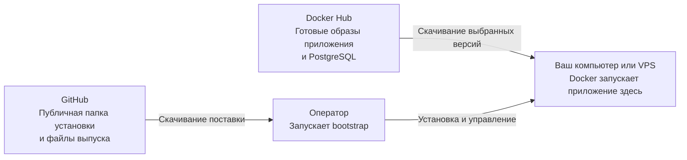
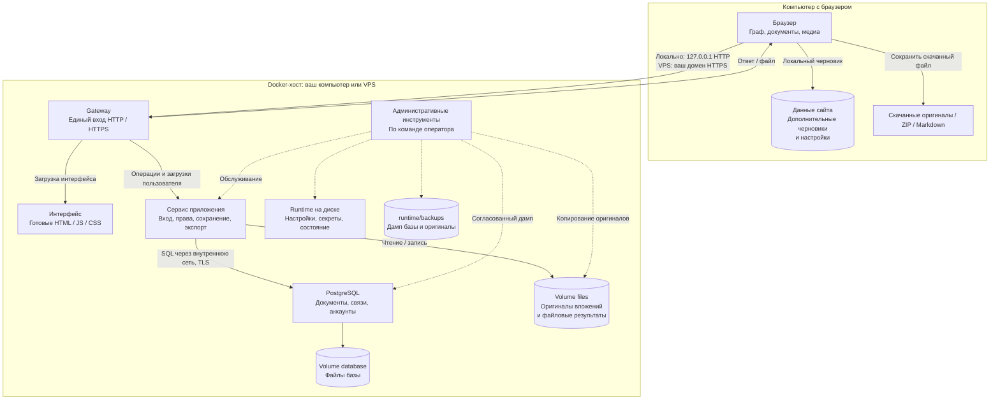
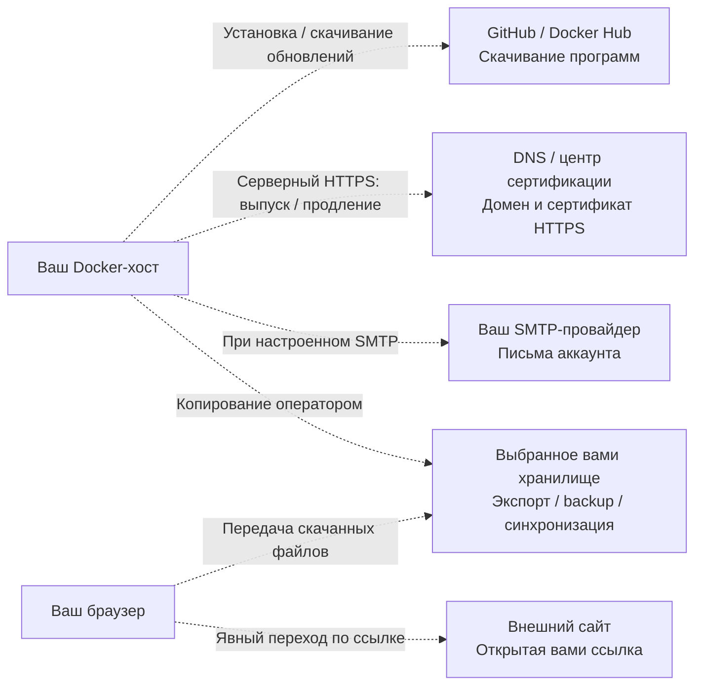

# Данные и безопасность: как работает TraceWeave

*[English](../en/data-and-security.md)*

**Данные находятся на том хосте, где вы запускаете Docker.** При локальной установке это ваш компьютер. При установке на VPS — удалённый сервер; его оператор и провайдер входят в границу доверия. Браузер также хранит дополнительные черновики на компьютере, с которого вы открыли приложение.

Ниже описана стандартная поставка 0.1.0. Схема отражает конфигурацию и реализацию; она не является независимым аудитом безопасности или гарантией отсутствия уязвимостей.

## От скачивания до запуска

GitHub и Docker Hub нужны для получения программ и обновлений. Исследования не отправляются туда штатными командами установки. Сервисы скачивания видят ваше соединение, IP-адрес и запрошенные файлы/версии. Приватные исходники компонентов и вход в реестр для запуска не нужны. После скачивания образов локальная работа с загруженными материалами не требует интернета.

## Путь документов и файлов

Сплошные стрелки — пользовательские запросы и данные; ответы возвращаются тем же путём. Пунктир — действия оператора. В локальном режиме браузер и Docker находятся на одном компьютере; при VPS между ними проходит сеть. PostgreSQL и сервис приложения не публикуют собственных портов на хост. Браузер работает через gateway; контейнер интерфейса отдаёт файлы UI, а сам React выполняется в браузере.

## Где лежат данные

| Что | Где | Кто получает доступ |
| --- | --- | --- |
| Тексты документов, атрибуты, связи, положения, аккаунты и служебные записи | PostgreSQL; volume `database` в `/var/lib/postgresql` контейнера БД | Сервис приложения через БД, административные tools, администратор хоста |
| Неизменяемые оригиналы вложений и файловые результаты | Volume `files`, `/var/lib/traceweave` сервиса приложения | Авторизованный пользователь через приложение; tools и администратор хоста |
| Настройки, секреты, состояние и журнал установки | Каталог `runtime/` или абсолютный `TW_RUNTIME_DIR` | Оператор и административные инструменты; необходимые файлы подключаются к сервисам |
| Полная резервная копия | `runtime/backups/`: дамп PostgreSQL и оригиналы | Оператор и любой получивший эту копию |
| Сертификаты HTTPS и состояние gateway | Volumes `gateway_data` и `gateway_config` | Gateway и администратор хоста |
| Сохранённые файлы предыдущего интерфейса | Volume `previous_assets` | Сервис интерфейса; это файлы программы, не резервная копия исследований |
| Несохранённые черновики и настройки интерфейса | IndexedDB / localStorage в профиле браузера | Пользователь этого профиля, имеющие доступ расширения/программы и администратор устройства |
| Скачанные оригиналы, Markdown и ZIP | Папка загрузок, выбранное хранилище, Obsidian и другие приложения | Каждый, кому вы передали файл или доступ к папке |

Имена volumes в таблице логические. Реальные имена с префиксом установки сохранены в `runtime/installation.json`. На Linux volumes находятся в хранилище Docker на хосте; на macOS — на диске Linux-среды Docker, который хранится на Mac. `runtime/` остаётся обычной папкой хоста.

Bootstrap создаёт именованные volumes автоматически. Выбор произвольной папки для файлов БД или оригиналов не реализован. `TW_RUNTIME_DIR` меняет только место настроек, секретов и backup. Штатная остановка/замена контейнера сохраняет volumes; удаление volume или диска Docker уничтожает соответствующие данные. Копирование только папки установки не копирует базу.

Браузерный черновик — дополнительная защита, не подтверждённая запись сервера. Очистка данных сайта, удаление профиля или авария могут потерять несохранённое. Не очищайте профиль до сохранения/скачивания нужного черновика.

## Что может выйти в интернет

| Получатель | Когда и что получает |
| --- | --- |
| GitHub / реестр образов | При скачивании поставки/образов: IP и запрос программных файлов. Автоматической отправки исследований этим сервисам нет |
| DNS, центр сертификации | На сервере: домен, IP/сетевые запросы, данные для выдачи/продления TLS-сертификата. Публичный сертификат не делает содержимое исследования публичным |
| SMTP и почта получателя | При подтверждении email/сбросе пароля: адреса, письмо и одноразовая ссылка, адрес вашей установки. Тексты документов и оригиналы не входят в эти письма. SMTP-провайдер способен прочитать письмо; TLS не скрывает его от провайдера |
| Внешний сайт | После вашего явного открытия ссылки/источника изображения: IP и сам URL, включая его query-параметры. Приложение применяет `noopener noreferrer`, но это не скрывает IP и адрес назначения |
| Хранилище резервных копий/экспорта | Всё, что вы туда скопировали. Cloud sync папки, Obsidian-плагины и другие программы работают по собственным правилам |

В стандартном интерфейсе нет телеметрии, LLM, сторонней аналитики, внешних runtime-шрифтов/CDN и автоматического просмотра URL. Raw HTML в Markdown выключен; внешние изображения не загружаются автоматически. Сохранение ссылки не вызывает её загрузку сервером. Подключение SMTP — явное исключение для писем аккаунта; локальному режиму SMTP не требуется. Обновления устанавливаются командой оператора.

**Контейнеризация не является полной изоляцией от интернета.** Gateway имеет внешнюю сеть, а сервис приложения — сеть для SMTP. Эти сервисы технически способны устанавливать исходящие соединения. Описание штатных потоков не заменяет контроль egress на вашем хосте и наблюдение за трафиком.

## Что защищено и кому вы доверяете

- Вход и проверка прав ограничивают доступ через приложение; оригиналы выдаются через авторизованный маршрут и находятся вне статической папки интерфейса.
- VPS использует HTTPS браузер → gateway; соединение приложения с PostgreSQL защищено TLS с проверкой сервера. Локальный loopback HTTP выбран явно. Внутренние HTTP-соединения gateway с сервисами не имеют отдельного TLS.
- **База, оригиналы, локальные черновики и резервные копии не шифруются самим TraceWeave.** Это не сквозное шифрование. Шифрование диска/backup настраивает владелец; TLS защищает транспорт.
- Администратор ОС, Docker или PostgreSQL может прочитать данные. На VPS вы доверяете оператору и провайдеру; разные аккаунты приложения не защищены от администратора хоста.
- Управляющий tools-контейнер в Docker-only режиме получает Docker socket и административные полномочия. Постоянные сервисы приложения этот socket не получают. Доверяйте источнику images и проверенному manifest; digest фиксирует содержимое, но не доказывает безопасность программы.
- Компрометация браузера, расширения, устройства, сервера или учётной записи может раскрыть данные. Открытие скачанного файла в другой программе — отдельная граница риска; проверка формата загрузки не является антивирусом.

## Как проверить свою установку

1. Выполните `./traceweave.sh status`: проверьте адрес, режим, релиз и volumes. Для локальной установки ожидается `http://127.0.0.1:8080` либо выбранный loopback-порт; для VPS — ваш HTTPS-домен.
2. Откройте DevTools → Network. После загрузки страницы очистите список, откройте/сохраните **синтетический** документ: запросы приложения должны идти только к origin вашей установки. Этот просмотр не показывает исходящий трафик Docker-хоста.
3. В синтетическом документе добавьте внешнее изображение в Markdown: без нажатия ссылки запроса к нему быть не должно. Переход по ссылке — ваше явное разрешение браузеру обратиться к сайту.
4. Для серверной части используйте собственный firewall/сетевой монитор: отдельно смотрите скачивание images, DNS/сертификаты и SMTP. Полный захват может содержать чувствительные данные; не публикуйте его.
5. Создайте [backup](operations.md), убедитесь в завершении и храните полную копию на отдельном защищённом носителе. Проверку restore проводите на тестовой установке. Backup содержит данные **всех** аккаунтов и приватные записи аутентификации; это не обычный пользовательский экспорт.

Эти шаги помогают проверить ожидаемое поведение; они не подтверждают отсутствие всех возможных утечек. [Записанные проверки и ограничения](testing.md).

---

[Документация](index.md) · [README](../../README-ru.md)
